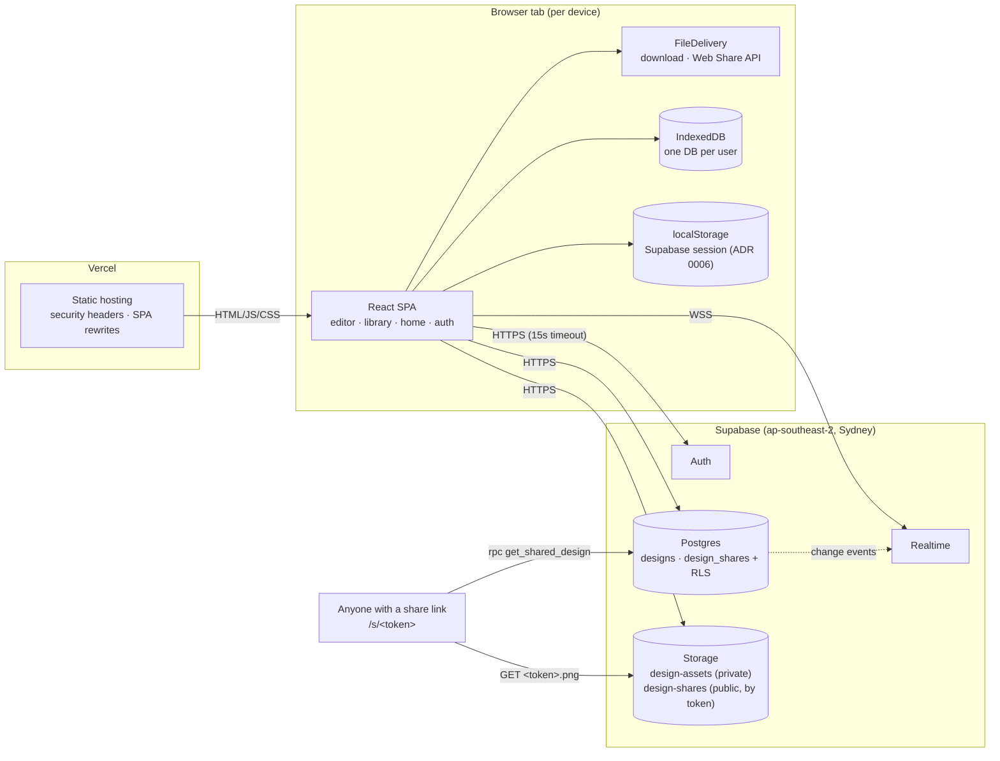
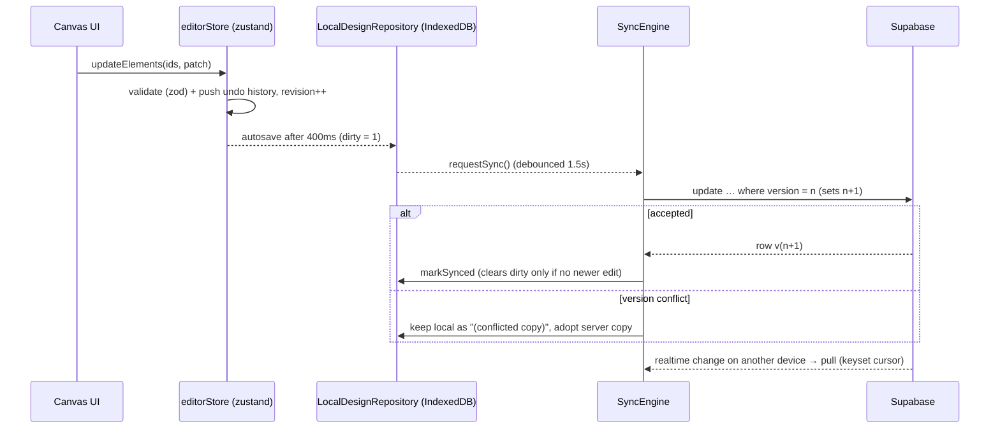

# Architecture

## Containers

## Data flow for an edit

## Key properties

- **Local-first.** The UI only ever talks to the local database. Sync is a background process that can fail without affecting editing.
- **Per-user isolation.** On the device, each account gets its own IndexedDB database (`canvas-studio-<userId>`). In the cloud, RLS policies restrict every row and storage object to `auth.uid()`.
- **No lost work.** Optimistic concurrency (`version`) detects concurrent edits; the losing side becomes a separate design instead of being overwritten. Deletions are tombstones, so they propagate too. Sync passes are serialised across browser tabs with a Web Lock, so two tabs never push the same edit.
- **Versioned documents.** Documents carry `schemaVersion`; old ones are upgraded by pure step migrations on read, and ones from a newer deploy pause sync with "reload to update" instead of being skipped (ADR 0007).
- **Validated boundaries.** Exported files (zod plus file signatures), cloud rows (zod), dropped drag payloads (zod), uploads (MIME allow-list, signatures, size, SHA-256 integrity on download) and new or patched elements are all validated.
- **Hardened browser surface.** A build-time CSP (`script-src 'self'`, network and images limited to the configured Supabase host), plus HTTP headers from `vercel.json`: HSTS, `frame-ancestors 'none'`, nosniff, COOP and a restrictive Permissions-Policy. The session is in browser storage, so XSS is treated as the critical risk (ADR 0006).

- **Public only by token.** Share links expose one PNG and title per shared design through a security-definer lookup by exact token; nothing public can be listed (ADR 0008).
- **Authorisation is tested.** RLS policies and SQL functions have tests in `supabase/tests/`, run on Postgres in CI.

See `docs/adr/` for the reasoning behind each choice.
