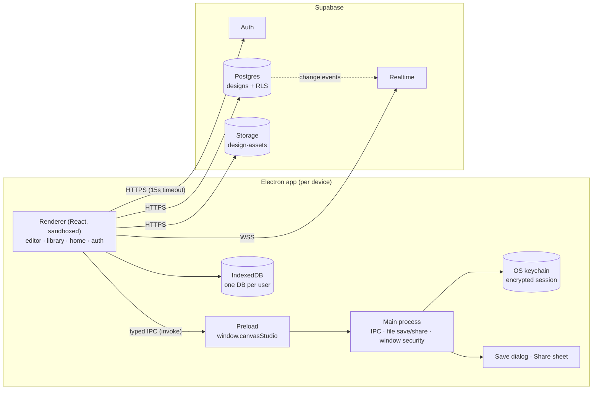
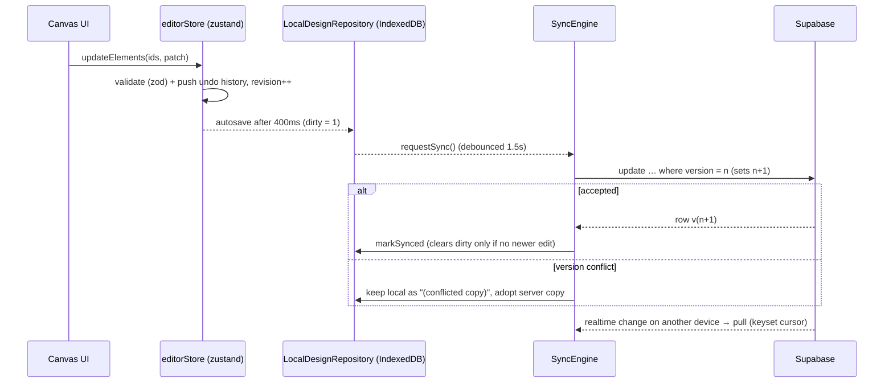

# Architecture

## Containers

## Data flow for an edit

## Key properties

- **Offline-first.** The UI only ever talks to the local database. Sync is a background process that can fail without affecting editing.
- **Per-user isolation.** On the device, each account gets its own IndexedDB database (`canvas-studio-<userId>`). In the cloud, RLS policies restrict every row and storage object to `auth.uid()`.
- **No lost work.** Optimistic concurrency (`version`) detects concurrent edits; the losing side becomes a separate design instead of being overwritten. Deletions are tombstones, so they propagate too.
- **Validated boundaries.** IPC payloads (zod plus file signatures), cloud rows (zod), dropped drag payloads (zod), uploads (MIME allow-list, signatures, size, SHA-256 integrity on download) and new or patched elements are all validated.
- **Hardened Electron.** Context isolation, sandbox, no Node in the renderer, IPC sender origin checks, navigation and new windows blocked (https opens in the browser), and a strict CSP limiting network access to the configured Supabase host.

See `docs/adr/` for the reasoning behind each choice.
