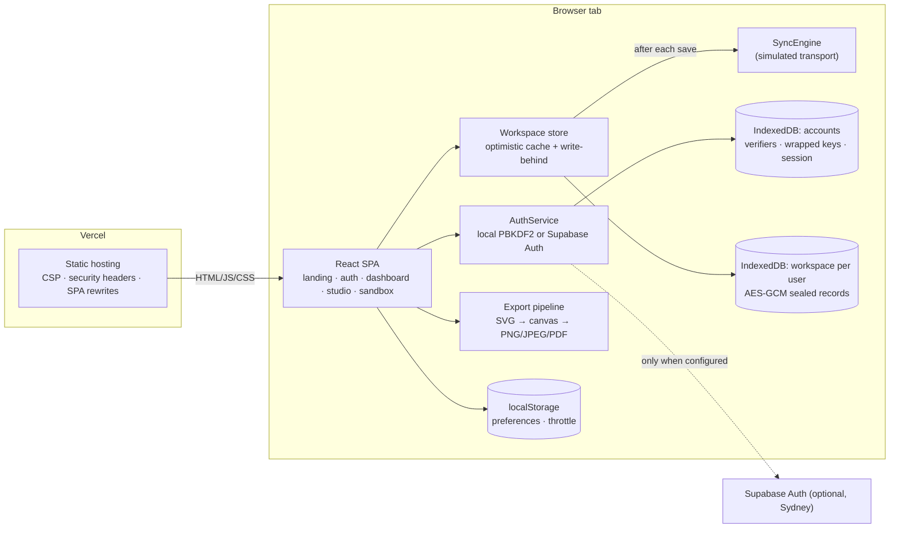
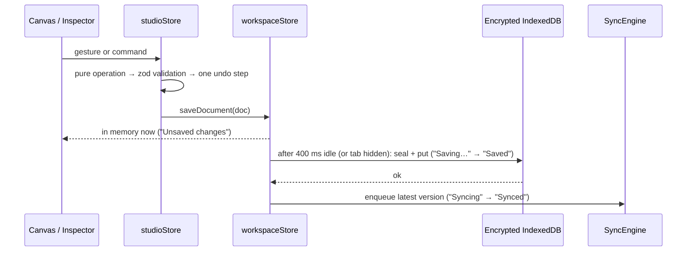

# Architecture (v2)

v1's architecture (Konva canvas, Supabase sync and share links) is in git history and ADRs 0001–0008. v2 is described below; the decisions behind it are ADR 0009 (renderer) and ADR 0010 (accounts, encryption, sync).

## Containers



## Module layout

```
src/
  main.tsx              wiring: logger, text metrics, config, services
  app/                  App shell, router, service container, composition root
  shared/               logger, crypto (AES-GCM), lib (ids, time, file names, storage), ui (design system)
  modules/
    document/domain     schema (zod), geometry, operations, history, snapping, text layout, layers, project query
    library/            templates, presets, icon catalog, template picker
    render/             DesignSvg + shape geometry + SVG serialiser
    workspace/          storage ports, encrypted IndexedDB + memory stores, optimistic cache, upload rules
    auth/               domain (credentials, throttle), application (AuthService + ports), infrastructure, AuthPage
    sync/               SyncEngine, simulated transport, status chip
    export/             options, pipeline, browser encoders, file delivery, dialog
    share/              email drafts, share dialog
    preferences/        theme/accent/density/scale/editor settings
    dashboard/          projects page, filters, cards
    studio/             editor store, gestures, shortcuts, commands, panels, canvas
    landing/
```

Dependencies point inward: `domain` folders import only other domain code and zod; adapters implement ports from `application`/`data`; components reach services through context hooks, never through concrete adapters.

## Data flow for an edit



During a drag, `previewGesture` replaces the present document without history; `endGesture` records one undo step and one save.

## Key properties

- **Single renderer.** Editor, thumbnails and exports all use `DesignSvg` (ADR 0009).
- **Validated boundaries.** Documents read from storage, every operation result, uploads (magic bytes, size, dimensions; no SVG), URL filters, redirect targets, export file names and email recipients are validated.
- **Encrypted at rest.** Workspace records are AES-GCM sealed with a per-account key that only the password unlocks (ADR 0010).
- **Optimistic, never lossy.** Edits land in memory instantly. A failed save keeps the edit and offers a retry; a failed delete rolls back; deletes offer undo for 10 s.
- **Split by route.** The landing and auth pages load first; the dashboard, studio, `react-dom/server` (SVG export), jsPDF and supabase-js are separate chunks loaded on demand.
- **Hardened browser surface.** Build-time CSP (`script-src 'self'`), HTTP headers from `vercel.json`, no raw HTML injection (lint-enforced).
